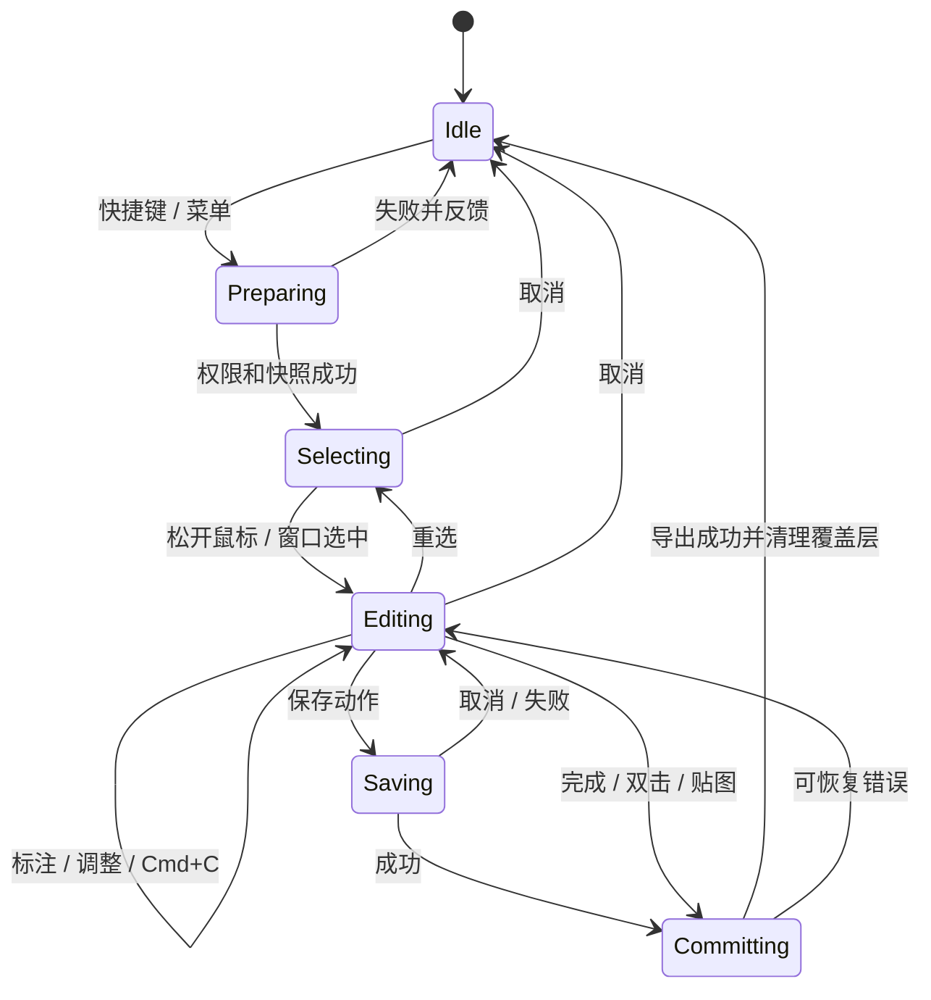

# 拾影 Framelet 0.3.0：截图体验设计与执行计划

日期：2026-10-27。设计负责人：当前 Codex。执行负责人：Orca 中的 Pi，模型 DeepSeek V4 Pro。基线提交：110c21f。

## 目标与范围

把现在的截图原型升级为日常可用的截图工具：快捷键唤起、拖选、选区旁直接标注、一次完成即可粘贴。截图流程不打开专用编辑器；导入已有图片仍可使用编辑窗口。产品保持拾影自己的品牌和原生实现。

用户明确要求借鉴 iShot 的交互，并指出缺少自动复制和快捷键设置。当前 0.2.0 虽已有原地工具栏，但还只有硬编码快捷键、固定完成动作、简陋设置和不完整选区操作，不能称为达到目标。此次不是把所有 iShot 功能一次列为已实现，而是完整补齐下面的首轮范围。

## 依据与判断

已现场查看本机 iShot 2.6.9（build 20260831001）设置，并使用 REA 读取其 arm64 Objective-C 元数据、定位处理函数。研究记录见《iShot-交互与逆向研究记录.md》。当前用户配置的“双击完成”是保存到剪贴板，可选贴图、OCR、保存、保存并复制、无动作；保存时同时复制另有开关。它不是只有截图与编辑两个孤立页面，而是有截图会话、完成策略、工具快捷键、全局快捷键几个协作部分。

不能据此认定 iShot 在松开鼠标时就自动覆盖剪贴板，也不能把当前用户配置说成出厂默认。Framelet 默认在“完成”时自动复制最终图，这是本设计对用户需求的具体解释；松开鼠标保留可编辑状态，不写剪贴板。按完成后无需再打开窗口、找文件或点第二次复制。

## 首轮必须实现的产品行为

### 1. 原地截图主流程

- 快捷键或菜单进入截图后显示冻结画面、十字光标、像素尺寸；拖动时只显示选区反馈。
- 松开鼠标后，在选区下方显示一行主要工具。下方空间不足放上方，再不足贴近可用屏幕边界。不可出现一半在另一块屏幕、按钮被裁掉或只能横向滚动才找到完成的情况。
- 主工具：移动选区、矩形、椭圆、箭头、画笔、文字、马赛克、遮挡；独立操作：撤销、重做、重选、OCR、贴图、保存、取消、完成。保留已有能力，不因重做界面丢失 OCR 或贴图。
- 工具属性（颜色、线宽、文字字号等）按所选工具展开第二条紧凑属性栏；未选标注工具时不常驻无关属性。主栏约 40–46 pt 高，触控目标至少 28 pt。使用自己的 SF Symbols 和视觉样式，不复制 iShot 资源。
- 选区有八个调整点，可移动、调整大小、重选；不能因为已有标注而让调整点突然失效。框选与画图命中区域明确，拖动工具栏不会误画。
- 原始屏幕图保持不变，裁剪与标注按同一坐标映射渲染。移动/调整选区时保持标注的屏幕位置不跳动，选区外标注导出时裁切；撤销/重做覆盖选区调整及标注，不用拉伸已有文字与线条。实现若采用其他模型，须先在交付记录说明与此行为的差异。
- 多屏时每块屏幕管理自己的图像、点坐标与像素比例；首轮选区限定在单块屏幕，不虚称支持跨屏拼接。全屏与窗口截图也进入同一原地完成流程。

### 2. 完成、剪贴板与保存

默认策略：完成按钮、Enter、选区空白处双击均执行“复制最终图片并退出”。双击只在移动/选区状态生效；绘制工具、文字输入和工具栏的双击不触发完成。

设置中可选默认完成动作：复制、保存文件、保存并复制、贴图。双击动作可设“跟随完成动作”或“无动作”；OCR 保持独立工具，不把异步 OCR 结果误当截图完成。

- Cmd+C：复制最终图片，保留截图会话，给出简短“已复制”反馈。Enter/完成执行配置动作并退出。这两个动作有意分工，设置与提示保持一致。
- 文字编辑器获得焦点时 Cmd+C/Cmd+V/Cmd+A/Cmd+Z/Enter 属于文字编辑；Enter 确认文字，不结束截图；再次 Enter 才完成截图。Esc 优先取消当前文本编辑或关闭弹层，再退出截图。
- 保存时是否同时复制为独立开关，默认开；贴图时是否同时复制为独立开关，默认开。这是为满足本产品用户的顺手粘贴需求而做的设计，不宣称 iShot 默认如此。
- 保存成功后才结束会话、写入“最近保存位置”；取消保存面板回到同一选区和标注；失败可重试，不能伪报已保存。
- 始终先成功编码最终渲染图，再改写剪贴板，避免 clearContents 后编码失败清空用户数据。包含标准 PNG/TIFF 图像类型，验证在原生目标中实际可粘贴，而非仅验证字节非空。
- 取消截图不更改剪贴板；Cmd+C 已明确复制后再取消则保留已复制的图，不强行恢复旧内容。完成只提交一次，避免双击、Enter、异步回调竞态重复保存或开两个贴图窗口。
- 贴图直接浮动，支持拖动、缩放、关闭、复制和保存；不能跳转主工作台，也不调用 iShot。

### 3. 可用的快捷键设置

应用菜单 Cmd+,、菜单栏及工作台都能打开设置，至少分为“截图”“快捷键”“保存”“权限与关于”。设置界面文字和菜单提示来自同一模型，不能界面显示新快捷键、实际仍注册旧键。

全局快捷键动作：区域截图、全屏截图、窗口截图、上次区域截图（成功截图后记忆、屏幕变化时校验）。保留现有区域 Ctrl+Option+4、全屏 Ctrl+Option+3 作为默认；其余可初始未设置。不要抢占用户已在 iShot 使用的 Option+4。

- 点击录制器后实际按键录入，支持清除、取消、单项恢复默认、全部恢复默认。显示标准 macOS 修饰键符号及当前键盘布局可识别的按键名。
- 全局组合要求至少一个 Command/Control/Option，拒绝裸字符和仅 Shift；拒绝应用内重复，Carbon 返回占用/失败时指出具体动作与原因。
- 换键按事务处理：失败后保留旧绑定可用，不出现设置写成功但快捷键失效。只禁用对应冲突动作，其他动作仍可用。
- 录制时暂停截图触发，失焦、取消、关闭设置均可靠恢复。重复注册不叠加事件监听，退出/解绑释放资源。
- 区分全局快捷键和截图会话内工具键。会话内默认 1 矩形、2 椭圆、3 箭头、4 画笔、5 马赛克、6 文字、7 遮挡、V 移动、T 贴图、O OCR；支持修改/恢复默认并检查重复。文本输入期间不劫持字符键。
- 当前没有实现的动作不能用一个能录入但永远不生效的设置占位。

### 4. 持久化和会话稳定性

- 有类型的设置模型，UserDefaults 持久化，含 schemaVersion 与安全默认值；重启后快捷键、完成策略、保存位置/格式、工具颜色/线宽/字号保持。未知枚举/损坏设置回退且提示可恢复，不能启动崩溃。
- 保存格式首轮 PNG/JPEG，默认 PNG；JPEG 明确质量值并处理透明背景。默认目录为用户图片目录下 Framelet，允许选择；若目录不可写则显示错误或选择位置，不静默丢图。现有导入/导出格式保持兼容。
- 截图开始隐藏本应用工作台，记录前台应用；完成/取消后清理所有屏幕覆盖层、事件监听、临时窗口，再恢复此前前台应用，不强行打开工作台。
- 会话状态明确：idle → preparing → selecting → editing → committing → idle；保存面板/文字编辑/OCR 是受会话管理的子状态。连按快捷键、权限拒绝、屏幕断开、保存取消和异常均能回到可再次截图状态。
- OCR 完成时必须校验会话/文档身份；退出或换选区后的迟到结果不能打开旧弹层、写错文档。
- 权限缺失时解释具体缺口，提供系统设置入口；不反复自动弹授权，不修改其他软件快捷键或设置。

## 会话与界面示意



```text
         选区像素尺寸
    ┌───────────────────────────┐
    │ 屏幕原图 + 原地标注        │
    │                           │
    └───────────────────────────┘
    [移动 形状 箭头 画笔 文字 脱敏 | 撤销 重做 | OCR 贴图 保存 × ✓]
                   [当前工具属性]
```

主操作始终可见；小屏幕优先将次要标注工具收进明确的更多菜单，不能隐藏完成/取消。第二行只在需要时出现。选区边缘的调整点与尺寸标签不受工具栏遮挡；辅助提示不承载唯一操作入口。

## 建议实现边界

沿现有 AppKit/SwiftUI + ScreenCaptureKit + Vision 技术栈迭代，不引入与本轮需求无关的框架。

| 模块 | 责任 | 现有入口 |
|---|---|---|
| AppSettings / SettingsStore | 持久化与默认值、配置校验 | 新建；替换 Views.swift 简陋设置 |
| HotKeyRegistry / ShortcutRecorder | 全局注册事务、录制、状态反馈 | HotKeys.swift |
| CaptureSession / CompletionPolicy | 生命周期、动作路由、防重复提交 | Capture.swift / App.swift |
| SelectionGeometry | 八点调整、坐标与跨 DPI 映射 | CaptureLayout.swift / Imaging.swift |
| AnnotationCanvas / InlineToolbar | 原地标注、属性、焦点与工具快捷键 | Canvas.swift / InlineCaptureToolbar.swift |
| CaptureExport | 统一渲染、编码、剪贴板与文件成功语义 | Model.swift / Imaging.swift |

按责任拆分到可理解的文件即可，不预先搭建大型插件架构。纯几何、策略、设置编解码放 FrameletCore 方便无 GUI 校验；AppKit 操作留在主应用。发布版不包含目标软件二进制、反编译代码或图标。

## 执行顺序与交付物

1. 在 Orca 独立工作树核对基线及本计划，列出与实际代码不符之处后开始实现；不再开展全仓无关重构。
2. 先落设置模型与全局快捷键，交付真实可操作的设置；再打通所有完成策略和统一导出语义。
3. 改进截图会话、八点选区、焦点、紧凑工具栏和会话内工具快捷键；接入既有 OCR、贴图与窗口截图。
4. 完成下列验证，修复本次引入的问题，版本改为 0.3.0，更新 README、使用说明与验收记录。产出当前工作树内的 app/DMG 与源码包；本轮不提交 Apple 公证、不上传官网，不改动原工作区现有安装包。
5. 在本地分支提交清晰 commit；无远程仓库，不伪造 PR。交付文件路径、提交号、已运行验证与真实缺口。不能只交计划或半完成 UI。

## 验收场景

| 场景 | 验收结果 |
|---|---|
| 区域截图 → 画箭头/文字 → Enter → 粘贴到原生应用 | 粘贴得到最终标注图，截图覆盖层退出，没有专用编辑窗口 |
| 只框选 → 双击 | 默认复制并完成；文字/画图双击不误触 |
| Cmd+C 后继续画图再完成 | 第一次复制不退出，最终复制包含后来标注 |
| 取消截图 | 不写剪贴板，不弹工作台，可再次快捷键截图 |
| 保存 → 取消；保存 → 不可写路径；保存成功 | 前两项保留会话与标注；成功后按策略复制/退出 |
| 修改区域快捷键，测试冲突，再重启 | 有效键生效且持久；无效换键旧绑定仍可用；提示指向具体动作 |
| 文本框内输入 1/T/O、换行/复制/撤销 | 正常编辑文字，不触发工具切换或提前完成 |
| 调整选区八点、移到屏幕边缘、小屏幕 | 尺寸与导出一致，工具栏操作可达，标注无意外拉伸 |
| Retina / 非 Retina、副屏负坐标 | 不裁错、不模糊缩放、不出现半屏偏移；无对应硬件时如实标记未实测 |
| OCR 中退出/重选、连续触发快捷键 | 迟到结果不复活旧窗口，无重复会话，无残留覆盖层 |
| 全屏/窗口/上次区域/贴图 | 复用完成策略且实际生效；贴图浮窗支持复制和关闭 |
| 设置重启/坏值恢复 | 默认与持久设置明确，未知值不崩溃 |

构建：bash scripts/swift.sh build --product Framelet。
已有轻量检查：bash scripts/swift.sh run FrameletChecks。按风险补充有价值的设置、策略、几何回归检查，不照抄实现逐函数测试。当前环境是 CommandLineTools，不假设有完整 Xcode/XCTest。

界面验收必须实际运行；无法使用 UI 工具或触及系统权限人工步骤时，交付中写明未验证项目，不能以编译通过替代界面通过。不要为了测试终止用户其他任务或覆盖原始工作区。

## 后续路线，不属于本次完成声明

滚动长截图、录屏/录音、翻译、截图历史库、云同步、复杂编号/高亮工具列入后续评估。它们不以灰按钮和空设置冒充支持。官网首发仍需后续完成真实签名、公证、隐私文案与分发检查；已有 0.2.0 DMG 不能代表新版已发布。
